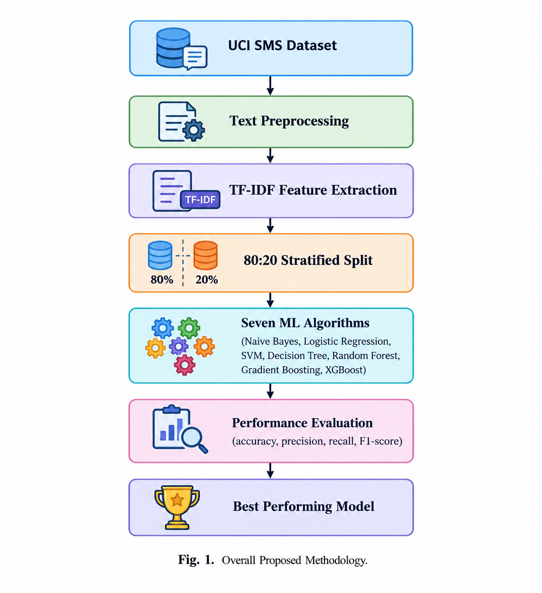
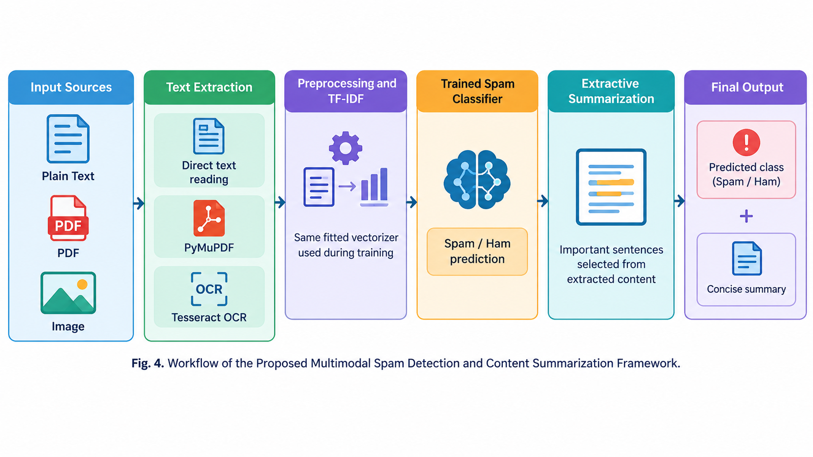
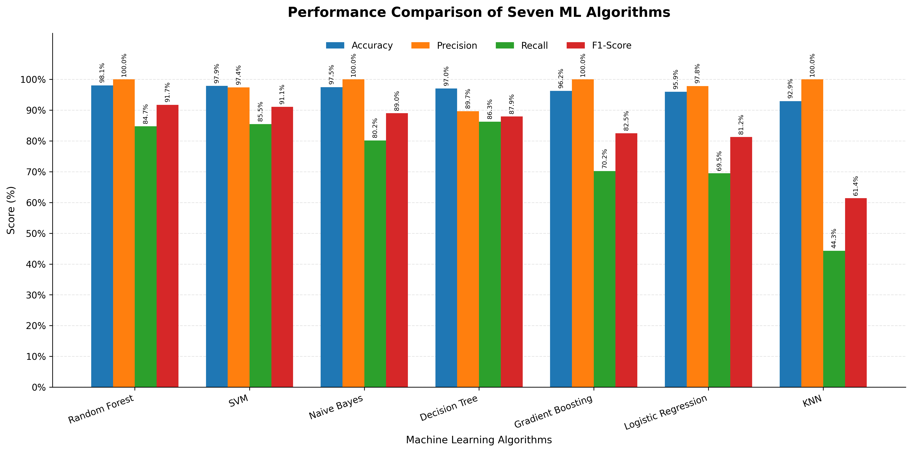
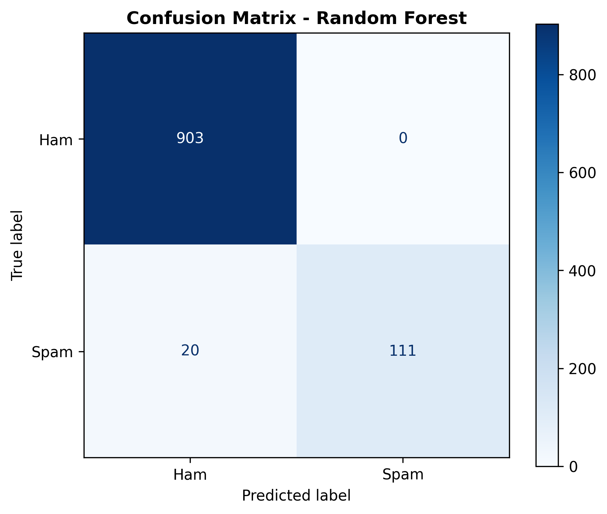

# Comparison of Machine Learning Algorithms for Spam Detection with Multimodal Input Support

[](https://www.python.org/)
[](LICENSE)
[](https://scikit-learn.org/)
[](#researcher-information)

---

## 1. Project Title

**Comparison of Machine Learning Algorithms for Spam Detection with Multimodal Input Support**

---

## 2. Researcher Information

- **Researcher:** Chhavi Kumari  
- **UID:** 25MCA20323  
- **Institution:** University Institute of Computing, Chandigarh University, Punjab, India  

*(This repository hosts an individual Master of Computer Applications (MCA) research project.)*

---

## 3. Abstract / Project Overview

The continuous proliferation of digital communication channels has led to a significant increase in unsolicited, fraudulent, and malicious spam communications. Identifying and filtering spam is critical for safeguarding user privacy, network bandwidth, and device security. 

This research conducts a systematic comparative evaluation of seven supervised machine learning algorithms for spam detection using the benchmark **UCI SMS Spam Collection dataset**. The text preprocessing pipeline implements unigram and bigram **Term Frequency–Inverse Document Frequency (TF-IDF)** feature extraction over an **80:20 stratified split**. Seven diverse classification algorithms—**Multinomial Naive Bayes, Logistic Regression, Support Vector Machine (Linear SVM), Decision Tree, K-Nearest Neighbors (KNN), Random Forest, and Gradient Boosting**—are empirically benchmarked across Accuracy, Precision, Recall, F1-Score, and Confusion Matrix analysis.

In addition to algorithmic benchmarking, this project implements an **application-level Multimodal Input Support pipeline**. While machine learning models are conventionally restricted to raw text input, real-world spam frequently arrives in heterogeneous document formats such as digital PDF attachments or embedded image banners. The proposed application integrates **PyMuPDF** for digital PDF text parsing and **Tesseract OCR** for image text extraction, passing extracted content through the trained TF-IDF vectorizer and top-performing classifier to deliver automated spam/ham predictions.

> **Note:** This repository represents an academic research project. The models are evaluated on the standard UCI SMS Spam Collection benchmark, and multimodal support is provided as an application-level ingestion pipeline.

---

## 4. Problem Statement

Spam messages have transitioned beyond standard SMS notifications into multifaceted digital mediums, including promotional image flyers, unsolicited PDF brochures, and phishing invoices. These unsolicited messages present serious risks:
- Financial scams, credential harvesting, and identity theft.
- Network bandwidth saturation and cloud storage depletion.
- High false positive risk where legitimate communications (*ham*) are erroneously discarded.

Traditional rule-based keyword filters are rigid and fail to adapt to adversarial manipulations (such as character substitution and obfuscation). While supervised machine learning offers adaptive classification, organizations require clear empirical evidence to balance high detection recall against precision. Moreover, a practical spam filter must ingest text across varied formats (plain text, digital documents, and images) rather than handling text in isolation.

---

## 5. Research Objectives

1. **Systematic Algorithmic Comparison:** Empirically evaluate seven supervised machine learning algorithms under identical preprocessing, feature extraction, and stratified data splits.
2. **Feature Representation Optimization:** Formulate a robust TF-IDF vectorization scheme using unigrams and bigrams (`max_features=3000`, `min_df=2`) with stopword removal.
3. **Multi-Metric Performance Analysis:** Evaluate classifiers using Accuracy, Precision, Recall, and F1-Score to identify models that prevent false spam flags while maximizing spam detection.
4. **Application-Level Multimodal Support:** Implement an input pipeline capable of parsing text from plain SMS, digital PDF documents (via PyMuPDF), and scanned images (via Tesseract OCR) for downstream classification.

---

## 6. Dataset Description

The core experimental comparison is conducted on the benchmark **UCI SMS Spam Collection dataset**:

- **Source:** UCI Machine Learning Repository (contributed by Tiago A. Almeida and José María Gómez Hidalgo).
- **Total Records:** 5,574 raw English SMS messages.
- **Labels:** Binary classification — `ham` (legitimate) and `spam` (fraudulent / unsolicited).
- **Data Cleaning:** Duplicates are detected and purged, resulting in **5,169 unique records** (4,516 ham and 653 spam).
- **Class Imbalance:** The dataset exhibits natural real-world imbalance (~87.4% ham vs. ~12.6% spam).

> **Dataset Scope Clarification:** The seven machine learning algorithms are trained and evaluated strictly on the text-based UCI SMS Spam Collection benchmark. The multimodal input support functions at the application level to extract text from PDFs and images prior to classification; the models were not trained on a combined multimodal image/audio dataset.

---

## 7. Machine Learning Algorithms

Seven diverse supervised learning paradigms are benchmarked:

1. **Multinomial Naive Bayes (MNB):** A probabilistic classifier based on Bayes' Theorem with feature conditional independence assumptions; highly efficient for text frequency distributions.
2. **Logistic Regression (LR):** A linear classification model using the sigmoid function to map log-odds of text features to class probabilities with L2 regularization ($C=1.0$).
3. **Support Vector Machine (Linear SVM):** An optimization method seeking the maximum margin hyperplane separating ham and spam feature vectors in high-dimensional TF-IDF space.
4. **Decision Tree (DT):** A non-parametric model utilizing recursive partitioning based on feature purity criteria to create human-interpretable decision boundaries.
5. **K-Nearest Neighbors (KNN):** An instance-based non-parametric classifier evaluating Euclidean distance in TF-IDF feature space; $k$ is optimized via 3-fold cross-validation ($k \in [3, 5, 7]$).
6. **Random Forest (RF):** An ensemble bagging technique constructing 100 randomized decision trees to reduce variance and mitigate single-tree overfitting.
7. **Gradient Boosting (GB):** An ensemble boosting technique sequentially constructing decision trees that minimize residual pseudo-response errors.

---

## 8. Proposed Methodology

The research methodology consists of two coordinated components:

```
[ UCI SMS Spam Dataset ] ──> [ Preprocessing & Cleaning ] ──> [ TF-IDF Feature Extraction ]
                                                                       │
                                                            [ 80:20 Stratified Split ]
                                                                       │
                                                       ┌───────────────┴───────────────┐
                                                       ▼                               ▼
                                            [ 7 Supervised ML Models ]     [ Performance Evaluation ]
                                                       │                   (Acc, Prec, Recall, F1)
                                                       ▼                               │
                                            [ Best Model: Random Forest ] ◀────────────┘
                                                       │
                                   ┌───────────────────┴───────────────────┐
                                   ▼                                       ▼
                       [ Application Input Pipeline ]          [ Trained Classifier ]
                       (Text / PDF via PyMuPDF / Image via OCR)                │
                                   └───────────────────┬───────────────────┘
                                                       ▼
                                            [ Spam / Ham Prediction ]
```

### Methodology Flowchart
The comprehensive data preparation, feature extraction, hyperparameter tuning, and model selection pipeline:



---

## 9. TF-IDF Feature Extraction

Term Frequency–Inverse Document Frequency (TF-IDF) transforms unstructured text strings into numerical vectors:

$$\text{TF-IDF}(t, d, D) = \text{TF}(t, d) \times \text{IDF}(t, D)$$

Where:
- $\text{TF}(t, d)$ represents the frequency of term $t$ in document $d$.
- $\text{IDF}(t, D) = \log\left(\frac{1 + |D|}{1 + |\{d \in D : t \in d\}|}\right) + 1$ dampens universally frequent words.

**Vectorizer Configuration:**
- `max_features`: 3,000 top n-gram tokens.
- `ngram_range`: `(1, 2)` capturing both unigrams (individual words) and bigrams (two-word phrases such as *"free entry"*, *"cash prize"*, *"urgent call"*).
- `min_df`: 2 (terms must appear in at least two documents).
- `stop_words`: Standard English stop words removed.
- **Data Integrity:** The vectorizer is fitted strictly on the training partition and transformed on test and inference inputs to guarantee zero data leakage.

---

## 10. Multimodal Input Support

To address diverse digital communication vectors, the application layer implements multimodal content ingestion:

1. **Plain Text Modality:** Direct SMS messages or plain text strings fed directly to preprocessing.
2. **Digital PDF Modality:** Extracted programmatically using **PyMuPDF (`fitz`)**, parsing internal font streams and document text blocks.
3. **Scanned PDF & Image Modality:** Processed via **Optical Character Recognition (Tesseract OCR / `pytesseract`)** and Pillow, reading alphanumeric text from image formats (`.png`, `.jpg`, `.jpeg`).

Once text is extracted from the respective modality:
- The text is normalized (lowercased, whitespace cleaned).
- The text is transformed using the pre-fitted TF-IDF vocabulary.
- The trained machine learning classifier predicts whether the extracted content is **SPAM** or **HAM**.

---

## 11. System Workflow

The end-to-end processing workflow operates sequentially:

```
Text / PDF / Image
       │
       ▼
Text Extraction / OCR
  ├─ Text: direct read
  ├─ PDF: PyMuPDF extraction
  └─ Image: Tesseract OCR
       │
       ▼
Text Preprocessing
(lowercasing, cleaning, tokenization)
       │
       ▼
TF-IDF Feature Transformation
       │
       ▼
Trained ML Classifier
(Random Forest / Linear SVM / Naive Bayes)
       │
       ▼
Spam / Ham Prediction
       │
       ▼
User Output
(Predicted class + Confidence score + Heuristic indicators)
```



---

## 12. Experimental Setup

- **Hardware & Environment:** Python 3.8+ execution environment.
- **Dataset Partitioning:** 80% Training (4,135 samples) and 20% Testing (1,034 samples), stratified on class labels with `random_state=42`.
- **Model Hyperparameters:**
  - **Random Forest:** `n_estimators=100`, `random_state=42`, `n_jobs=-1`.
  - **Support Vector Machine:** `LinearSVC`, penalty L2, $C=1.0$, `random_state=42`.
  - **Multinomial Naive Bayes:** Laplace smoothing `alpha=1.0`.
  - **Decision Tree:** Gini impurity, `random_state=42`.
  - **K-Nearest Neighbors:** Optimized via 3-fold cross-validation on training F1-score ($k=3$).
  - **Gradient Boosting:** `n_estimators=100`, `learning_rate=0.1`, `max_depth=3`, `random_state=42`.
  - **Logistic Regression:** Regularization $C=1.0$, `max_iter=1000`.

---

## 13. Performance Evaluation

Because spam datasets are intrinsically imbalanced, models cannot be judged on accuracy alone. Evaluation employs four standard metrics:

1. **Accuracy:** $\frac{TP + TN}{TP + TN + FP + FN}$ — overall correctness proportion.
2. **Precision:** $\frac{TP}{TP + FP}$ — percentage of detected spam that was genuinely spam (minimizing False Positives).
3. **Recall (Sensitivity):** $\frac{TP}{TP + FN}$ — percentage of actual spam correctly caught (minimizing False Negatives).
4. **F1-Score:** $2 \times \frac{\text{Precision} \times \text{Recall}}{\text{Precision} + \text{Recall}}$ — harmonic mean providing the primary benchmark ranking.
5. **Confusion Matrix:** Explicit accounting of True Positives ($TP$), True Negatives ($TN$), False Positives ($FP$), and False Negatives ($FN$).

---

## 14. Experimental Results

### Benchmark Comparison Table

All seven algorithms benchmarked on the identical 80:20 stratified test set:

| Rank | Algorithm | Accuracy (%) | Precision (%) | Recall (%) | F1-Score (%) |
| :---: | :--- | :---: | :---: | :---: | :---: |
| 🥇 | **Random Forest** | **98.07%** | **100.00%** | 84.73% | **91.74%** |
| 🥈 | **Support Vector Machine (SVM)** | 97.87% | 97.39% | **85.50%** | 91.06% |
| 🥉 | **Multinomial Naive Bayes** | 97.49% | **100.00%** | 80.15% | 88.98% |
| 4 | **Decision Tree** | 97.00% | 89.68% | 86.26% | 87.94% |
| 5 | **Gradient Boosting** | 96.23% | **100.00%** | 70.23% | 82.51% |
| 6 | **Logistic Regression** | 95.94% | 97.85% | 69.47% | 81.25% |
| 7 | **K-Nearest Neighbors (KNN)** | 92.94% | **100.00%** | 44.27% | 61.38% |

### Performance Comparison Bar Chart


### Confusion Matrix (Top Performing Model: Random Forest)


### Key Analytical Findings:
1. **Random Forest** achieved the highest overall F1-score (**91.74%**) and Accuracy (**98.07%**), attaining a perfect **100.00% Precision** with zero False Positives ($FP = 0$). This ensures legitimate messages are never flagged as spam.
2. **Linear SVM** delivered the strongest balance with an F1-score of **91.06%** and the highest recall among high-precision classifiers (**85.50%**).
3. **Multinomial Naive Bayes, Gradient Boosting, and KNN** all achieved **100.00% Precision**, but varied significantly in Recall (from 80.15% down to 44.27%), highlighting the importance of composite metrics like F1-Score over raw accuracy.

---

## 15. Technology Stack

- **Core Language:** Python 3.8+
- **Machine Learning & NLP:** `scikit-learn`, `numpy`, `pandas`
- **Visualization:** `matplotlib`, `seaborn`
- **Digital Document Processing:** `PyMuPDF` (`fitz`), `pypdf`
- **Optical Character Recognition:** `pytesseract`, `Pillow` (PIL)
- **Version Control:** Git & GitHub

---

## 16. Project Structure

```plaintext
.
├── dataset/                                 # Benchmark datasets
│   ├── SMSSpamCollection                    # Cleaned UCI SMS Spam Collection
│   ├── sms+spam+collection.zip              # Original UCI distribution archive
│   ├── spambase.zip                         # Reference email dataset
│   └── README.md                            # Dataset documentation
├── figures/                                 # Flowcharts and result visualizations
│   ├── multimodal_spam_detection_workflow.png
│   ├── multimodal_spam_detection_workflow_vertical.png
│   ├── proposed_methodology_flowchart.png
│   ├── model_comparison.png
│   ├── confusion_matrix.png
│   └── sample_multimodal_image.jpeg
├── results/                                 # Experimental output files
│   ├── model_comparison_results.csv         # Full 7-model benchmark data
│   └── results_summary.md                   # Markdown results report
├── src/                                     # Modular Python source code
│   ├── sms_spam_detection.py                # 7-model training & evaluation pipeline
│   ├── multimodal_detector.py               # Multimodal ingestion & prediction module
│   └── SMS_Colab.py                         # Standalone Google Colab runner
├── paper/                                   # Research paper & reference literature
│   ├── Comparison_of_Machine_Learning_Algorithms_for_Spam_Detection_with_Multimodal_Input_Support.docx
│   ├── Comparison_of_Machine_Learning_Algorithms_for_Spam_Detection_with_Multimodal_Input_Support.pdf
│   └── Intelligent_Email_Spam_Detection_A_Machine_Learning-Based_Approach.pdf
├── SMS.PY                                   # Main root execution script
├── requirements.txt                         # Python package dependencies
├── LICENSE                                  # MIT License (source code & docs)
├── .gitignore                               # Git ignore configuration
└── README.md                                # Comprehensive project documentation
```

---

## 17. Installation and Execution

### 1. Clone the Repository
```bash
git clone https://github.com/ckseth/Comparison-of-Machine-Learning-Algorithms-for-Spam-Detection-with-Multimodal-Input-Support.git
cd Comparison-of-Machine-Learning-Algorithms-for-Spam-Detection-with-Multimodal-Input-Support
```

### 2. Set Up Virtual Environment & Dependencies
```bash
python -m venv venv
# On Windows:
.\venv\Scripts\activate
# On Linux/macOS:
source venv/bin/activate

pip install -r requirements.txt
```

*(Optional for Image OCR)*: Ensure Tesseract OCR engine is installed on your OS:
- **Windows:** `winget install UB-Mannheim.TesseractOCR`
- **Linux:** `sudo apt-get install tesseract-ocr`
- **macOS:** `brew install tesseract`

### 3. Run the ML Benchmark Comparison
To train and benchmark all seven algorithms on the UCI dataset:
```bash
python SMS.PY
```
Or run the modular script with custom arguments:
```bash
python src/sms_spam_detection.py --dataset dataset/SMSSpamCollection --output-dir .
```

### 4. Run Multimodal Spam Classification

**Text Modality:**
```bash
python src/multimodal_detector.py --modality text --input "URGENT! You have won a 1 week free holiday to Hawaii. Call 09061743811 now to claim!"
```

**Digital PDF Modality:**
```bash
python src/multimodal_detector.py --modality pdf --input "sample_document.pdf"
```

**Image OCR Modality:**
```bash
python src/multimodal_detector.py --modality image --input "figures/sample_multimodal_image.jpeg"
```

---

## 18. Limitations and Future Scope

### Limitations
- **Domain Specificity:** Models are trained on SMS communications; grammatical patterns in formal business emails may vary.
- **OCR Quality Dependency:** Tesseract OCR performance depends on input image resolution, font legibility, and noise artifacts.
- **Static Vocabulary:** TF-IDF represents fixed unigram and bigram vocabularies, lacking semantic context across out-of-vocabulary misspellings.

### Future Scope
- **Deep Learning Architectures:** Fine-tuning transformer models (such as DistilBERT, RoBERTa, or spam-specialized BERT variants).
- **End-to-End Multimodal Representation:** Incorporating multimodal transformers (e.g., LayoutLM for PDFs and CLIP for image flyers).
- **Real-Time Deployment:** Packaging the detector into a containerized FastAPI microservice with automated document intake.

---

## 19. References

1. A. Chamoli, R. Chauhan, N. Bisht, S. Devliyal, et al., "Analysis of Spam Detection Techniques using Machine Learning," in *Proceedings of the 2024 Asia Pacific Conference on Innovation in Technology (APCIT)*, 2024, doi: [10.1109/APCIT62007.2024.10673701](https://doi.org/10.1109/APCIT62007.2024.10673701).
2. N. RamojiRao, S. Anusuya, Harshavardhini, C. Sembuli, et al., "Analysis of Email Spam Detection Using Naive Bayes and Support Vector Machine Classification Algorithms," in *Proc. 2024 IEEE 9th Int. Conf. Engineering Technologies and Applied Sciences (ICETAS)*, 2024, doi: [10.1109/ICETAS62372.2024.11120193](https://doi.org/10.1109/ICETAS62372.2024.11120193).
3. "Intelligent Email Spam Detection: A Machine Learning-Based Approach," in *Proc. 2025 5th Int. Conf. Trends in Material Science and Inventive Materials (ICTMIM)*, 2025, doi: [10.1109/ICTMIM65579.2025.10988140](https://doi.org/10.1109/ICTMIM65579.2025.10988140).
4. M. Raza, N. D. Jayasinghe, and M. M. A. Muslam, "A Comprehensive Review on Email Spam Classification using Machine Learning Algorithms," in *Proc. 2021 Int. Conf. Information Networking (ICOIN)*, pp. 327–332, 2021, doi: [10.1109/ICOIN50884.2021.9334020](https://doi.org/10.1109/ICOIN50884.2021.9334020).
5. D. Yadav and B. Kaur, "Machine Learning Models for Email Spam Detection: A Review," in *Proc. 2023 2nd Int. Conf. Smart Technologies for Smart Nation (SmartTechCon)*, 2023, doi: [10.1109/SmartTechCon57526.2023.10391620](https://doi.org/10.1109/SmartTechCon57526.2023.10391620).
6. E. H. Tusher, M. A. Ismail, M. A. Rahman, A. H. Alenezi, and M. Uddin, "Email Spam: A Comprehensive Review of Optimize Detection Methods, Challenges, and Open Research Problems," *IEEE Access*, vol. 12, pp. 143627–143657, 2024, doi: [10.1109/ACCESS.2024.3467996](https://doi.org/10.1109/ACCESS.2024.3467996).
7. T. A. Almeida, J. M. G. Hidalgo, and A. Yamakami, "Contributions to the study of SMS spam filtering: New collection and results," in *Proceedings of the 2011 ACM Symposium on Document Engineering (DocEng)*, 2011. [UCI Machine Learning Repository: SMS Spam Collection].
